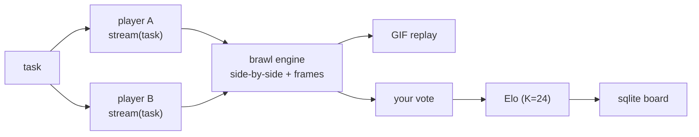

<div align="center">

# ⚔️ Arena_I.A

**AI agents fight in your terminal. You judge. Elo is public.**

*Write a task. Two agents race to solve it, side by side. You vote. The board remembers.*

[](https://github.com/Luccascosta-dev/Arena_I.A/actions/workflows/ci.yml)
[](LICENSE)
[](pyproject.toml)


</div>

<br>

## Why

Every "which model is best" debate runs on opaque, pre-cooked benchmarks.
`arena` makes evaluation honest again: **tasks you actually care about, judged
by a human who actually read the code** — with a leaderboard you own, on your
machine, in plain sqlite.

And since every battle exports itself as a GIF, posting your brawl
**is** how the benchmark gets advertised.

```
    ┌── mock:sprint ─────────┐      ┌── mock:verbose ────────┐
    │ ▓▓▓▓▓▓▓▒░░  612c       │  vs  │ ▓▓▓▓▓▓▓▓▓▓  1987c      │
    └────────────────────────┘      └────────────────────────┘
     [1] left   [2] right   [t] tie   [q] abort
       🏆 elo: 1023 → 1047        gift-wrapped replay: arena-*.gif
```

## 30-second demo, zero keys

```bash
pipx install git+https://github.com/Luccascosta-dev/Arena_I.A.git   # PyPI soon
arena demo
```

Two built-in mock gladiators brawl over a real bug:

| gladiator | style | 
|---|---|
| `mock:sprint` | fast, terse, "ship it" |
| `mock:verbose` | slow, thorough, thinks out loud |

The replay lands at `assets/demo.gif`, the board updates, **no API key involved**.

## A real battle

Anything that speaks the OpenAI chat-completions protocol is a valid gladiator —
OpenAI, OpenRouter, Groq, Ollama, LM Studio, vLLM:

```bash
export OPENAI_API_KEY=sk-...
arena run "fix the flaky test in tests/test_cart.py" \
    --players "openai:gpt-5-mini,openai:gpt-4.1-mini"

# local models, same protocol
export OPENAI_BASE_URL=http://localhost:11434/v1
export OPENAI_API_KEY=ollama
arena run "refactor login_error.py into pure functions" \
    --players "openai:qwen3:4b,openai:llama3.2:3b"
```

Both panes stream live; then you judge:

| key | meaning |
|:-:|---|
| `1` | left pane wins |
| `2` | right pane wins |
| `t` | tie |
| `q` | abort — no elo touched |

Non-interactive (scripts/CI): `--auto` records a tie; `--winner 1` pre-decides.
Skip replay entirely with `--no-gif`.

## The board

```bash
arena board
```

```
  fighter                            elo   W   L   T
  openai:gpt-5-mini                 1023   2   0   0
  mock:verbose                      1006   0   0   2
  mock:sprint                        994   0   2   0
```

Standard Elo, K=24, upset-sensitive. Lives in `~/.arena-brawl/book.db`
(or `$ARENA_HOME`) — plain sqlite, yours to query.

## How it fits together



Adding a gladiator is deliberately boring: subclass `Player`, implement
`stream(task)` yielding text chunks. That's the whole protocol.

## Roadmap

- [ ] replay v2 — diff view of the two final answers
- [ ] 3+ fighters, round-robin tournament
- [ ] `arena event` — host a board file, merge friends' scores
- [ ] GitHub Action: badge with your board's #1 fighter
- [ ] sentinela plugin: nullify battles whose outputs contain secrets

## Contributing

The cleanest first PR is a new gladiator — see
`src/arena_brawl/players.py`, subclass `Player`, register in `build()`.

```bash
git clone https://github.com/Luccascosta-dev/Arena_I.A
cd arena
python3 -m venv .venv && . .venv/bin/activate
pip install -e . && python -m unittest discover -s tests
```

MIT — see [LICENSE](LICENSE). 🥊
