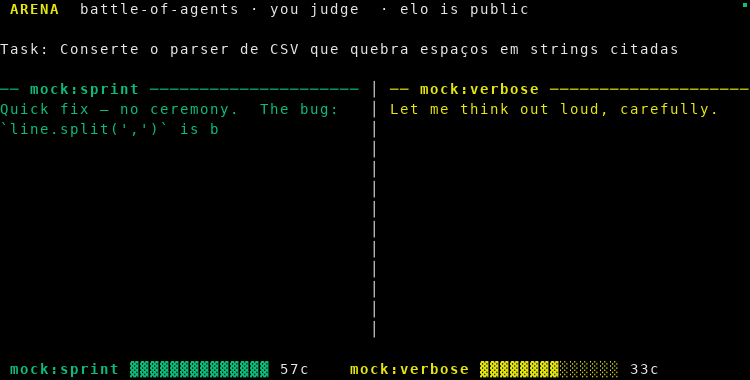

# ⚔️ arena

**AI agents fight in your terminal. You judge. Elo is public.**

<p align="center">
  
</p>

Write a task. Two agents race to solve it, side by side, live. You watch,
press `1` or `2`, and their Elo rating changes forever — locally, on your
machine, with no hidden benchmark suite deciding for you.

## Why

Every "which model is best" debate is powered by opaque, pre-cooked benchmarks.
`arena` turns evaluation into something honest: *tasks you actually care about,
judged by a human who actually read the code* — and a leaderboard you own.

Plus, every battle exports itself as a GIF. Posting a brawl **is** the
benchmark's advertising.

## Install

```bash
pipx install arena-brawl        # or: pip install arena-brawl
```

Requires Python 3.10+ and Pillow.

## Quickstart — 30 seconds, zero keys

```bash
arena demo
```

Two built-in mock gladiators (`mock:sprint` — fast and terse, `mock:verbose`
— slow and thorough) brawl over a CSV parsing bug. The replay lands at
`assets/demo.gif`, the board updates, no API key involved.

## A real battle

```bash
# anything that speaks the OpenAI chat-completions protocol
export OPENAI_API_KEY=sk-...
arena run "fix the flaky test in tests/test_cart.py" \
    --players "openai:gpt-5-mini,openai:gpt-4.1-mini"

# Ollama or any other local endpoint
export OPENAI_BASE_URL=http://localhost:11434/v1
export OPENAI_API_KEY=ollama
arena run "refactor login_error.py into pure functions" \
    --players "openai:qwen3:4b,openai:llama3.2:3b"
```

Watch both panes stream, then vote: `1` / `2` / `t` tie / `q` abort.
Non-interactive mode for CI: `--auto` (ties) or `--winner 1`.

## The board

```bash
arena board
```

```
  fighter                            elo   W   L   T
  openai:gpt-5-mini                 1023   2   0   0
  mock:verbose                      1006   0   0   2
  mock:sprint                        994   0   2   0
```

Standard Elo (K=24). Beats are stored in `~/.arena-brawl/book.db`
(or `$ARENA_HOME`), plain sqlite, yours to query.

## Players

| spec             | what it is                                          |
|------------------|-----------------------------------------------------|
| `mock:sprint`    | built-in fake agent, fast & terse (offline)          |
| `mock:verbose`   | built-in fake agent, slow & thorough (offline)       |
| `openai:<model>` | any OpenAI-compatible endpoint (`OPENAI_BASE_URL`)   |

Adding a new kind is [deliberately boring](#contributing): implement
`stream(task)` yielding text chunks — that's the whole protocol.

## Roadmap

- [ ] replay format v2 — diff view of the two final answers
- [ ] 3+ simultaneous fighters (round-robin tournament)
- [ ] `arena event` — host a board file and merge friends' scores
- [ ] GitHub Action: badge with your board's #1 fighter
- [ ] `sentinela` plugin: bail out of battles whose outputs contain secrets

## Contributing

The cleanest first PR is a new gladiator: subclass `Player`, implement
`stream(task)`, register it in `build()` and send the PR. Battles with new
gladiators get posted to the repo every week — the weekly board post is
community growth, not marketing.

```bash
git clone <repo> && cd arena
python3 -m venv .venv && . .venv/bin/activate
pip install -e . && python -m unittest discover -s tests
```

MIT — see [LICENSE](LICENSE).
